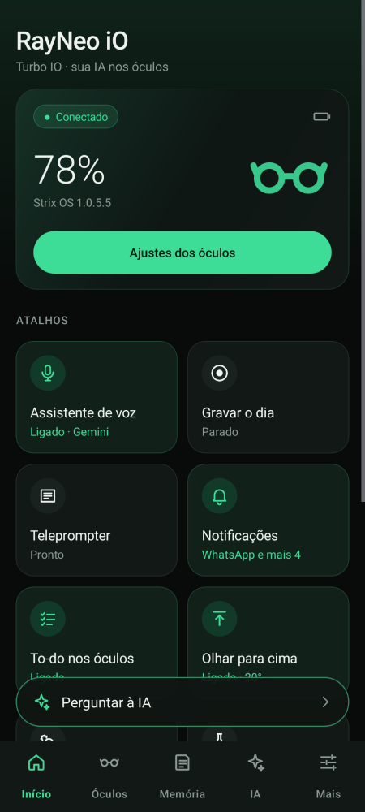
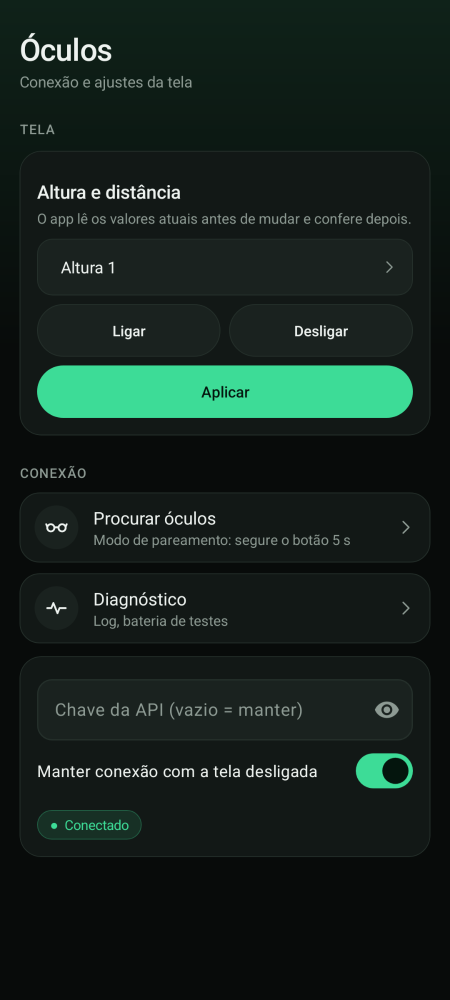

# Turbo IO Custom AI — Android companion for RayNeo iO glasses

An **independent Android app** that connects to **RayNeo iO** smart glasses over Bluetooth LE on the **stock Strix OS
firmware** and answers with **your own AI provider** (OpenAI, Google Gemini, Anthropic Claude or any OpenAI-compatible
API). Answers are short, in Brazilian Portuguese, and shown on the lenses.

On top of the assistant, the app adds:

* a searchable **journal** with daily insights;
* a **memory** of people and pending items, with proactive reminders;
* **ambient recording** through the glasses' microphones;
* integrations with the glasses' own apps: notifications, To-do, teleprompter, dashboard and weather.

The app lives in [`android-custom-ai/`](android-custom-ai/README.md).

> **Status:** version **0.4.0** (versionCode 8).
>
> **Proven on real hardware** (Galaxy S25 Ultra, Android 16, Strix OS 1.0.5.5): connection, guest authentication and
> real-time LifeLog audio.
>
> **Not yet confirmed on the glasses:** everything else, including lens display, voice and the 0.4.0 integrations. Each
> of these is marked "hardware pending" below.

## Safety first: the firmware is never touched

* **No firmware changes of any kind.** There is no code for OTA, flashing or downgrading. The firmware-update channel
  (business 9) is absent from the send path.
* **The official RayNeo app stays installed and usable.** This app uses its own package (`org.turboio.customai`) and
  does not modify or repackage the official APK.
* **Every outgoing message passes two gates:**
  * an allow-list of business/type pairs;
  * a content check that accepts only known commands and value ranges.

  Unit tests prove the refusals.
* **The file channel (business 18) is open only during a teleprompter session.**
  * It accepts only three message types: file info, chunk data and cancel.
  * The file name must be the session's random id, so it can never carry an update package.
  * Files are capped at 48 KB.
* **Changes to the glasses are reversible.** Settings and dashboard changes read the current state first, change only
  what you asked for, and read back to verify. The values read first are kept so you can restore them.
* **API keys are encrypted with the Android Keystore** (AES-256-GCM).
  * They are never in source code, `BuildConfig`, logs, backups or the APK.
  * Logs redact tokens and MAC addresses, and never store audio or notification text.

## Look

Dark interface with an emerald accent: a home screen with the glasses' status, shortcut tiles for every feature and an
"ask the AI" bar, and five tabs (Home, Glasses, Memory, AI, More).

<p>
  
  
</p>

## Features

### Connection

| Feature | Status |
| --- | --- |
| BLE discovery, guest authentication, system bond, battery and state readout | ✅ proven on hardware |
| Automatic reconnection with backoff, foreground service | ✅ on hardware: stable for 30 min after one early reconnect |

### AI assistant and lens display

| Feature | Status |
| --- | --- |
| Providers: OpenAI, Gemini, Anthropic, any OpenAI-compatible endpoint (model, endpoint, instructions, token limit, timeout, conversation context) | implemented · request formats and real endpoints tested |
| Short pt-BR answers: Markdown/emoji cleanup, paging, optional accent stripping | implemented · tested |
| Answers on the lenses (text session), with text size, position and line count | implemented · hardware pending |
| Voice assistant triggered on the glasses. **Glasses mic:** Gemini (same key as the AI), Deepgram Nova-3 (same key as ambient recording), OpenAI (Whisper / gpt-4o-transcribe) or Google Cloud Speech-to-Text. **Phone mic:** Android's built-in recognizer, no key needed | implemented · flow tested with synthetic Opus audio · hardware pending |
| "Hey RayNeo" wake word, enabled with the official app's command (turning it off requires the official app) | implemented · hardware pending |
| Free-phrase tasks: "I need to buy bread tomorrow" becomes a dated pending item | implemented · tested |

### Journal, insights and memory

| Feature | Status |
| --- | --- |
| Journal of every question and answer: accent-insensitive search, Markdown export, retention | implemented · tested on real SQLite |
| Daily insights (summary, highlights, tasks, decisions, commitments, people, quotes), automatic at 9 pm, readable on the lenses by voice ("summary of my day") | implemented · tested with a mock model |
| Memory: conversations become people and persistent pending items. Names come from context and need evidence. Items have due dates, a source and automatic completion. Privacy policies apply per conversation type | implemented · tested with a mock model |
| Proactive assistant: new-item alerts, reminders before due dates (with snooze), morning brief, weekly review | implemented · real use pending |
| Ask your memory by voice or text: "my pending items", "what do I have with Marina", "what did I say about costs last week" | implemented · tested |

### Ambient recording

| Feature | Status |
| --- | --- |
| Records through the **glasses' microphones** (real-time LifeLog) or the phone's. Transcription by **Deepgram Nova-3** (separates speakers) or OpenAI. The wearer's voice is identified by the glasses' voice sensor. Only speech is sent and billed; raw audio is deleted after transcription | implemented · audio format and signals validated on hardware |
| Start and stop recording from the glasses' own menu | ✅ mechanism validated on hardware |

### Integrations with the glasses' own apps (0.4.0)

| Feature | Status |
| --- | --- |
| App alerts (reminders, new items, morning brief) as the glasses' **native notification card** | implemented · hardware pending |
| **Android notifications** from the apps you choose (WhatsApp, e-mail, …). Duplicates and bursts are filtered; content is never stored | implemented · hardware pending |
| **Google Maps turn-by-turn** on the lenses ("200 m · Main St") | implemented · hardware pending |
| Pending items in the glasses' native **To-do** app, two-way: completing an item there completes it on the phone | implemented · hardware pending |
| **Teleprompter**: drive the glasses' built-in teleprompter from the phone. Paste text or open a `.txt`, then start, pause, resume, change speed and exit | implemented · wire bytes match the HarmonyOS reference · hardware pending |
| **Dashboard card** with a short pending-items summary ("3 pend · 15:00 Call") | not supported by Strix OS 1.0.5.5 (no answer to `widget_install`); disabled there |
| **Dashboard type** (simple/complete), with restore | ✅ change confirmed by read-back on the glasses |
| **Nod / shake cards**: confirm (nod) or discard (shake) items found in conversations | implemented · hardware pending |
| **Weather** on the home screen, from Open-Meteo (free, no key) | implemented · hardware pending |
| Display height/distance, double-tap-opens-To-do, and look-up-to-wake with its angle (`wakeupConfig`): read first, verified, restorable | implemented · hardware pending |
| Reacting to what you open on the glasses (opening To-do triggers a sync) | implemented · hardware pending |

### Diagnostics

| Feature | Status |
| --- | --- |
| Guided **feature test suite** (20 steps, one per feature): the app performs each action, shows what it saw, records the glasses traffic (redacted) and asks whether it worked on the lenses; one-ZIP export | implemented · awaiting execution on the glasses |
| Guided **hardware test suite** (audio/LifeLog) with on-screen cues and one-ZIP export. Steps: LifeLog script, start from the glasses' menu, native-app observation, native Recorder, 5-minute run, forced-stop recovery | implemented · LifeLog steps executed on the glasses |
| Diagnostics log (redacted), BLE communication test, "delete all app data" | implemented |

## Install and use

1. Get the APK (each delivery comes with its SHA-256) or build it yourself (below). Check the hash before installing.
2. On the phone: unlink the glasses in the official app, then *Forget* them in Android's Bluetooth settings.
3. Put the glasses in pairing mode: hold the button for about 5 s until the blue LED blinks.
4. In Turbo IO: **Connection → Find glasses**, select them and accept the system pairing dialog.
5. **AI tab:** choose a provider and model and paste your API key (stored encrypted).
6. **Tests tab:** send a test text and ask a question to see it on the lenses.

To go back to the official app, see [REVERSAO.md](android-custom-ai/docs/REVERSAO.md). Only one client can be connected
at a time.

## Build

```sh
cd android-custom-ai
export ANDROID_HOME=/path/to/Android/sdk
./gradlew testDebugUnitTest lintDebug assembleDebug
```

Requirements: JDK 17, Android SDK 35 (minSdk 26). The current build passes 154 unit tests with no lint errors.

## Documentation

The detailed documents are in Portuguese, under [`android-custom-ai/docs/`](android-custom-ai/docs):

| Document | Contents |
| --- | --- |
| [AUDITORIA.md](android-custom-ai/docs/AUDITORIA.md) | Repository audit and why this is an independent app |
| [ARQUITETURA.md](android-custom-ai/docs/ARQUITETURA.md) | Modules, BLE/voice/display/teleprompter/dashboard sequences, security gates |
| [INSTALACAO.md](android-custom-ai/docs/INSTALACAO.md) | Installation, pairing, API and voice setup |
| [TESTES.md](android-custom-ai/docs/TESTES.md) | Test results (development, Android, hardware) and hardware test checklists |
| [PERMISSOES_E_RISCOS.md](android-custom-ai/docs/PERMISSOES_E_RISCOS.md) | Permissions, APK integrity, risks and mitigations |
| [REVERSAO.md](android-custom-ai/docs/REVERSAO.md) | Returning to the official app and uninstalling safely |
| [DESIGN_DIARIO_E_GRAVACAO.md](android-custom-ai/docs/DESIGN_DIARIO_E_GRAVACAO.md) | Journal, insights, ambient recording and hardware probes |
| [MEMORIA_E_ASSISTENTE.md](android-custom-ai/docs/MEMORIA_E_ASSISTENTE.md) | Memory: people, pending items, proactivity, search, weekly review |
| [AJUSTES_DOS_OCULOS.md](android-custom-ai/docs/AJUSTES_DOS_OCULOS.md) | Glasses To-do, display settings, dashboard, nod/shake cards |
| [FEATURES_POSSIVEIS.md](android-custom-ai/docs/FEATURES_POSSIVEIS.md) | What else is possible on stock firmware, and what is already in the app |

## Roadmap

* **Hardware confirmation:** lens display, voice and every 0.4.0 integration (checklist in `TESTES.md`), plus
  long-run battery and stability.
* **Live captions and translation:** continuous transcription of the people around you, optionally translated, shown
  on the lenses. Alternatively, serving the glasses' native Captions app with your own AI.
* **Faster answers and on-device options:** streaming answers, and on-device recognition and text-to-speech.

## About this repository

This is a fork of [Turbo1123/Turbo-IO](https://github.com/Turbo1123/Turbo-IO). The Android app is a Kotlin port of the
fork's HarmonyOS protocol core (`harmony-sdk/turbo_core`), which was validated on hardware. The other top-level
directories (`harmony-sdk`, `official-addon`, `android-addon`, `apps`, `rayneo-*`, `firmware-research`, …) are
inherited from upstream. They serve only as protocol references: none of them is part of this app or built into its
APK.

Some upstream material concerns **modified firmware and flashing**. This project does not use or support any of it,
and you should not flash your glasses to use this app. The upstream project's original documentation is available in
the upstream repository.

## License and credits

* Original Turbo IO material: [PolyForm Noncommercial 1.0.0](LICENSE), for non-commercial use only (see
  [NOTICE](NOTICE) and [THIRD_PARTY_NOTICES.md](THIRD_PARTY_NOTICES.md)).
* Third-party components in the app: AndroidX, Material Components and kotlinx-coroutines (Apache-2.0), and Concentus
  (BSD-3).
* The APK contains no RayNeo binaries, SDKs or native libraries.
* This is an unofficial project, not affiliated with RayNeo; the name only identifies the device it works with.
